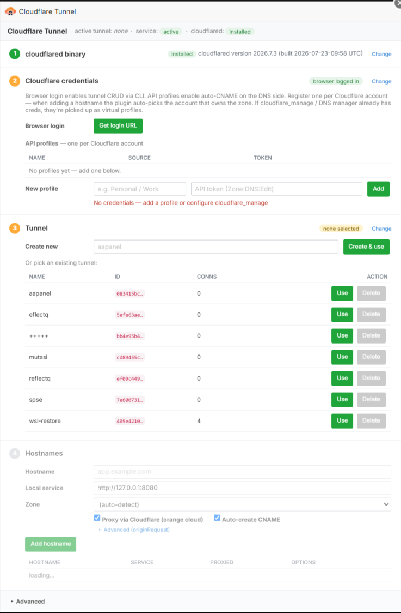

# Cloudflare Tunnel for AAPanel

Expose any AAPanel site through a Cloudflare Tunnel (cloudflared) — without opening a port, owning a public IP, or touching nginx vhosts. All ingress mapping, DNS, and the systemd service are managed from the panel UI.

<p align="center">
  
</p>

## Features

- One-click install/update of the `cloudflared` binary
- Guided setup: browser login → required API token → automatic account picker → tunnel → hostname; installs cloudflared automatically when needed
- Pre-filled API token creation link; automatically loads account names and defaults to the first returned account
- **Multi-account support** (v1.2.0) — register multiple Cloudflare accounts as *profiles*, plugin auto-picks the right one by matching the hostname to zones across all accounts
- Tunnel management via API tokens or per-profile cloudflared browser login
- Hostname → local service ingress rules (`http://127.0.0.1:80`, `tcp://…`, `http_status:404`, `hello_world`)
- **Per-hostname `originRequest`** overrides (v1.1.0) — `noTLSVerify`, `httpHostHeader`, `originServerName` (SNI), `connectTimeout`, `tlsTimeout`, `http2Origin`, `disableChunkedEncoding` — all from the UI, no manual `config.yml` editing
- Auto-creates / upserts the public CNAME on Cloudflare (`<sub>.zone → <tunnel-id>.cfargotunnel.com`, proxied)
- Reuses the **existing Cloudflare credentials** stored by AAPanel's `cloudflare_manage` plugin / DNS manager — surfaced as read-only *virtual profiles*, no need to re-enter your token
- DNS conflict protection, exact-record cleanup, checked service startup, and rollback of ingress/config/DNS on an observed apply failure; compensation errors and uncertain API writes are reported for manual repair
- Private credential files for locally managed tunnels; Cloudflare-managed tunnels are marked in the list and rejected for local configuration
- systemd lifecycle controls: install / start / stop / restart / uninstall
- Live `journalctl` view in the Advanced panel

## Install

### From the plugin archive (recommended)

1. Download the latest release: **[cloudflare_tunnel-1.4.0.zip](dist/cloudflare_tunnel-1.4.0.zip)**.
2. AAPanel → **App Store** → top-right **Import** (upload icon) → pick the zip.
3. Open the plugin → follow the **5-step wizard** (browser login → token → account → tunnel → hostname).

See the [1.4.0 changelog](CHANGELOG.md) for the highlights.

### From source (dev / symlink)

```bash
git clone https://github.com/fdciabdul/Cloudflare-Tunnel-aaPanel.git
cd Cloudflare-Tunnel-aaPanel
./install_to_aapanel.sh link    # symlink — edits go live without re-packaging
# or
./install_to_aapanel.sh         # copy
```

The script symlinks/copies `cloudflare_tunnel/` into `/www/server/panel/plugin/cloudflare_tunnel/`. Bounce the panel (`bt restart`) after first install or if you change Python files.

## Quick start

1. **Sign in to Cloudflare**: name the connection and click **Sign in to Cloudflare**. The plugin installs the connector if needed, then displays **Open Cloudflare login**. Open that link and authorize; the plugin automatically checks completion.
2. **Add API token**: click **Create API token**, create it in Cloudflare, paste it back and click **Save & continue**. A browser login and an API token are both required in the wizard.
3. **Choose an account**: accounts are loaded automatically. The first returned account is selected by default; choose another if needed, then click **Use account & continue**. No manual Account ID input is needed.
4. **Create or choose a tunnel**: create a new local tunnel or select an existing local one. The plugin writes its configuration and starts the service.
5. **Hostnames**: bind `app.example.com` to the intended website in aaPanel, then add `app.example.com → http://127.0.0.1:80`. Use the actual HTTP port if the site listens elsewhere.

Completed steps can be reopened with **Change**. Choose a saved connection at the top or click **Add connection** for another account. The window fits the viewport and scrolls; **Service & logs** opens Advanced directly, where binary updates and service controls are available.

The token template requests Tunnel Edit, Account Settings Read (account discovery), Zone Read and DNS Edit. Older tokens can fall back to account IDs from zone metadata or the browser-login certificate, with token access checked before selecting the account. Permission and API details are kept out of the setup form.

If automatic DNS is disabled, the form and completion dialog show the CNAME name, `<tunnel-id>.cfargotunnel.com` target, TTL and proxy status to create manually. Orange-cloud proxying is recommended for public HTTP/HTTPS Tunnel applications.

For the default route, visitors use HTTPS at Cloudflare, the tunnel transport is encrypted, and cloudflared connects to the local website over HTTP. No local SSL certificate or TLS override is needed. Turn off the site's unconditional Force HTTPS redirect when using this HTTP origin; changing the zone SSL mode does not change the tunnel's local service URL. See [Cloudflare's origin protocol guidance](https://developers.cloudflare.com/tunnel/troubleshooting/https-origins/).

HTTP(S) routes explicitly send the public hostname as the origin Host header unless a custom override is set. Wildcard routes preserve the incoming Host. **Check origin** on a saved HTTP route tests the local service with its Host header and reports connection failures, HTTP errors and HTTPS redirects. A local 404 can mean a domain binding, document root, index, application or PHP configuration issue; this check does not establish public DNS/tunnel connectivity.

If the website error log says `open_basedir restriction in effect`, PHP is refusing the script's path. After copying or renaming a website, check its `.user.ini` and PHP configuration for an old directory restriction and update it to the current site directory while retaining `/tmp/`. PHP can cache the previous setting for 5 minutes by default, even when the file on disk is correct. Wait for the cache to refresh or restart the site's PHP service, then retry and check fresh error log entries. The origin-check dialog includes this guidance. See [PHP's per-directory configuration documentation](https://www.php.net/manual/en/configuration.file.per-user.php).

### Upgrading to 1.4.0

The default for new routes is now HTTP port 80. Existing service addresses are preserved because custom applications may use other ports. For an existing aaPanel website rule still using the former example port 8080, choose **Edit**, set the actual local HTTP address (normally `http://127.0.0.1:80`), and save to apply the updated Host behavior. Use **Check origin** to diagnose a remaining 404.

Import the complete [1.4.0 ZIP](dist/cloudflare_tunnel-1.4.0.zip), then reopen the plugin. This update improves setup and upgrade reliability. Runtime profiles, tokens and ingress data are excluded from the archive.

If aaPanel still serves the old plugin page after import, restart the panel once (`bt restart`) and reopen the plugin.

### Validation scope

The package was checked with isolated backend/HTTP tests, wizard logic checks and upgrade regressions, including stale modules, identical timestamps and sizes, and incomplete file copies. Real aaPanel import, browser authorization, Cloudflare permissions and public connectivity still require validation on your server. No Node.js or npm packages are required or included.

## Multi-account

Use **Add connection** to register multiple profiles (e.g. `Personal`, `Work`, `Client-X`). When you add a hostname the plugin:

1. Loads zones for the chosen connection and account (60s cache)
2. Matches the hostname to the longest zone suffix in that account
3. Uses that profile's token for the CNAME upsert automatically

The zone dropdown uses the chosen connection and account:

```
▾ Zone
   ── Personal ──
      example.com
      app.dev
   ── Work ──
      corp.io
      internal.corp.io
```

## Architecture

```
cloudflare_tunnel/
├── info.json                  panel metadata
├── install.sh                 AAPanel install/uninstall hook
├── icon.png                   plugin tile icon
├── cloudflare_tunnel_main.py  dispatcher for /plugin?action=a&name=cloudflare_tunnel&s=…
├── tunnel_manager.py          cloudflared binary, login, tunnel CRUD, systemd
├── dns_manager.py             profile storage, credential discovery, Cloudflare API
├── ingress_manager.py         hostname↔service rules + originRequest, config.yml writer
├── manifest.json              checksums for complete upgrades
├── storage.py                 atomic private writes + shared mutation lock
├── index.html                 guided browser login / token / account / tunnel / hostname UI
└── data/                      runtime: state.json, ingress.json, api_profiles.json (gitignored)
```

### Credential precedence

The plugin considers profiles in this order (all can coexist):

1. Plugin-local profiles from `data/api_profiles.json` (added via Auth step, one per Cloudflare account)
2. Virtual profile from `cloudflare_manage` plugin's `cf_default.json`
3. Virtual profile from AAPanel DNS manager (`config/dns_mager.conf`, each `CloudFlareDns` entry)

Virtual profiles are read-only in the UI (managed by their owning plugin) but participate in zone matching just like local ones.

### Remote-managed tunnels

Tunnels managed in the Cloudflare dashboard pull their ingress from Cloudflare and ignore local rules. They are marked **Cloudflare managed** and cannot be selected for local editing. Manage their hostnames in Cloudflare, or create a new local tunnel through this plugin.

## Build the archive yourself

```bash
python3 - <<'PYBUILD'
import hashlib, json, pathlib, zipfile
root = pathlib.Path('cloudflare_tunnel')
files = ['install.sh', 'dns_manager.py', 'cloudflare_tunnel_main.py', 'index.html',
         'ingress_manager.py', 'tunnel_manager.py', 'storage.py', 'icon.png', 'info.json']
version = json.loads((root / 'info.json').read_text())['versions']
manifest = {'version': version, 'files': {
    name: hashlib.sha256((root / name).read_bytes()).hexdigest() for name in files}}
(root / 'manifest.json').write_text(json.dumps(manifest, indent=2) + '\n')
pathlib.Path('dist').mkdir(exist_ok=True)
with zipfile.ZipFile('dist/cloudflare_tunnel-' + version + '.zip', 'w', zipfile.ZIP_DEFLATED) as archive:
    for name in files + ['manifest.json']:
        archive.write(root / name, name)
PYBUILD
```

## License

MIT
